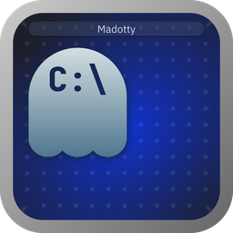

<p align="center">
  
</p>
<h1 align="center">Madotty</h1>
<p align="center"><a href="README.md">English</a> · <strong>日本語</strong></p>

Madotty は、[Ghostty](https://github.com/ghostty-org/ghostty) の Windows 移植版 [shiweis/ghostty-windows](https://github.com/shiweis/ghostty-windows) をベースにした、個人開発のターミナルです。

## インストール

[Releases](https://github.com/zszushi/Madotty/releases) から x64 用の MSI をダウンロードして実行してください。インストーラーは未署名です。

インストール後は、スタートメニューから **Madotty** を起動できます。

## タブ・ペインとフルスクリーン

| やりたいこと | 操作 |
| --- | --- |
| 画面を左右・上下に分割する | タブを別のペインの左端・右端・上端・下端にドラッグ |
| タブを別ウィンドウに移す | タブをウィンドウの外にドラッグ |
| 作業中のペインを閉じる | `Ctrl+Shift+W` |
| フルスクリーンに切り替える・元に戻す | `Ctrl+Enter` |

`Alt+Enter` でもフルスクリーンを切り替えるには、`%LOCALAPPDATA%\ghostty\config.ghostty` に次の1行を追加します。

```ini
keybind = alt+enter=toggle_fullscreen
```

## 外観

端末本文のフォントと、タブや設定画面のフォントを個別に選べます。Windows 11 22H2 以降では、OpenGL と DirectX 12 で Mica と Acrylic が使えます。**設定 → 外観** で素材を選び、背景の不透明度を下げると、文字の濃さを保ったまま背景に素材が見えます。

## パフォーマンス

開発に使っている PC で、Madotty の開発版（ReleaseFast、DirectX 12）と Windows Terminal 1.25.3131.0 の出力速度を測定しました。2026年11月20日の測定で、画面は120列 × 40行、1セルは10 × 20ピクセルです。各項目を2秒ずつ測定し、それぞれ3回の中央値を示しています。

| 測定項目 | Madotty | Windows Terminal |
| --- | ---: | ---: |
| ASCII スクロール | 295.7 MB/s | 252.9 MB/s |
| CJK 文字の出力 | 169.1 MB/s | 32.1 MB/s |
| 24ビットカラー（SGR） | 87.1 MB/s | 89.7 MB/s |

## このリポジトリについて

ビルド手順、キーボードショートカット、Ghostty コアの更新手順は[開発者向けガイド（英語）](docs/development.md)にまとめています。

現在、Issue と Pull Request の受付は休止しています。

## ライセンス

Madotty は [MIT ライセンス](LICENSE) で配布しています。
