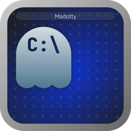

<p align="center">
  
</p>
<h1 align="center">Madotty</h1>
<p align="center"><strong>English</strong> · <a href="README.ja.md">日本語</a></p>

Madotty is a terminal emulator for Windows. It’s a personal project based on [shiweis/ghostty-windows](https://github.com/shiweis/ghostty-windows), a Windows port of [Ghostty](https://github.com/ghostty-org/ghostty).

## Installation

Download the x64 MSI from the [Releases page](https://github.com/zszushi/Madotty/releases) and run it. The installer is unsigned.

Once installed, open **Madotty** from the Start menu.

## Tabs, panes and fullscreen

| Action | How |
| --- | --- |
| Split the view | Drag a tab to the left, right, top or bottom edge of another pane. |
| Move a tab to its own window | Drag the tab outside the window. |
| Close the focused pane | Press `Ctrl+Shift+W`. |
| Enter or leave fullscreen | Press `Ctrl+Enter`. |

You can customize keybindings in `%LOCALAPPDATA%\ghostty\config.ghostty`. For example, adding the following line lets you toggle fullscreen with either `Ctrl+Enter` or `Alt+Enter`.

```ini
keybind = alt+enter=toggle_fullscreen
```

## Appearance

Choose the terminal font separately from the font used in tabs and settings. On Windows 11 22H2 or later, the OpenGL and DirectX 12 renderers support Mica and Acrylic. Select a material in **Settings → Appearance** and lower the background opacity to see it behind the text. The text stays opaque.

## Performance

I measured terminal output throughput on one PC using a Madotty development build (ReleaseFast, DirectX 12) and Windows Terminal 1.25.3131.0. The figures are medians of three runs per terminal on November 20, 2026, with a 120 × 40 grid, 10 × 20 pixel cells, and two seconds per workload.

| Workload | Madotty | Windows Terminal |
| --- | ---: | ---: |
| ASCII scrolling | 295.7 MB/s | 252.9 MB/s |
| CJK text output | 169.1 MB/s | 32.1 MB/s |
| 24-bit color (SGR) | 87.1 MB/s | 89.7 MB/s |

## About this repository

Build instructions, keyboard shortcuts, and notes on the shared Ghostty core are in the [Windows development guide](docs/development.md).

Issues and pull requests are currently closed.

## License

Madotty is available under the [MIT License](LICENSE).
